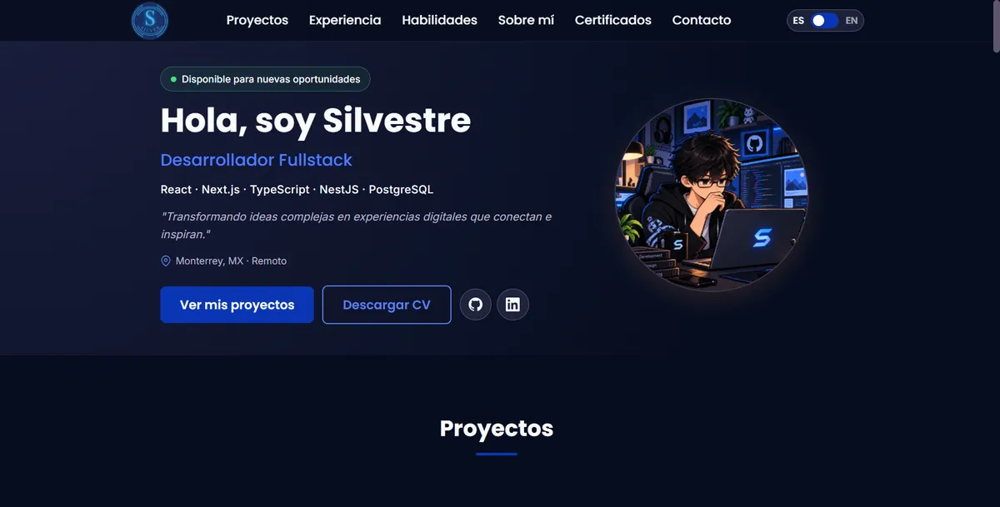

<div align="center">

# Silvestre Hernández — Portafolio

**Desarrollador Fullstack · Monterrey, MX**

[](https://silver442.github.io/)
[](https://www.linkedin.com/in/silvestre-hernandez-822240244/)



</div>

## Sobre el proyecto

Mi portafolio personal: proyectos, experiencia, habilidades y un formulario de contacto. Está hecho **sin frameworks ni build tools** —HTML, CSS y JavaScript vanilla— para mantenerlo ligero, rápido y fácil de mantener.

## Características

- **Bilingüe (ES / EN)** con cambio instantáneo y preferencia guardada en `localStorage`.
- **Responsivo**, diseñado primero para móvil.
- **Accesible**: navegación por teclado, menú y modal con atributos ARIA, enlace para saltar al contenido y respeto de `prefers-reduced-motion`.
- **Optimizado**: imágenes WebP con dimensiones explícitas y carga diferida, íconos SVG inline reutilizados con `<use>`.
- **SEO**: metadatos Open Graph, URL canónica y datos estructurados `Person` (JSON-LD).
- **Animaciones** que respetan `prefers-reduced-motion`: entrada escalonada con `IntersectionObserver`, barra de progreso de lectura con scroll-driven animations, cambio de idioma con View Transitions y sección activa resaltada en el menú.
- **Correo protegido**: la dirección no aparece en texto plano en el HTML, para evitar que la recolecten bots de spam.
- **Formulario de contacto** con [Formspree](https://formspree.io/) y campo trampa contra spam.

**Lighthouse (móvil y escritorio):** Accesibilidad 100 · Buenas prácticas 100 · SEO 100.

## Tecnologías


## Estructura

```
├── index.html          # Página principal
├── 404.html            # Página de error de GitHub Pages
├── css/
│   ├── style.css       # Estilos base, variables y componentes
│   ├── movil.css       # Ajustes para pantallas ≤ 768px
│   └── desktop.css     # Ajustes para pantallas ≥ 800px
├── js/
│   ├── translations.js # Textos en español e inglés
│   └── main.js         # Menú, idioma, carrusel, modal, formulario y animaciones
├── Img/                # Imágenes (WebP) e íconos
└── docs/               # CV en PDF (ES / EN)
```

## Ejecutar en local

No requiere instalación. Abre `index.html` en el navegador o sirve la carpeta con cualquier servidor estático:

```bash
python -m http.server 8000
# http://localhost:8000
```

## Contacto

- Formulario de contacto en [silver442.github.io](https://silver442.github.io/#footer)
- LinkedIn: [Silvestre Hernández](https://www.linkedin.com/in/silvestre-hernandez-822240244/)
- GitHub: [@silver442](https://github.com/silver442)
